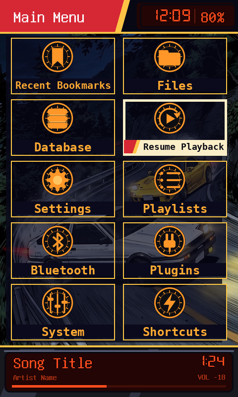
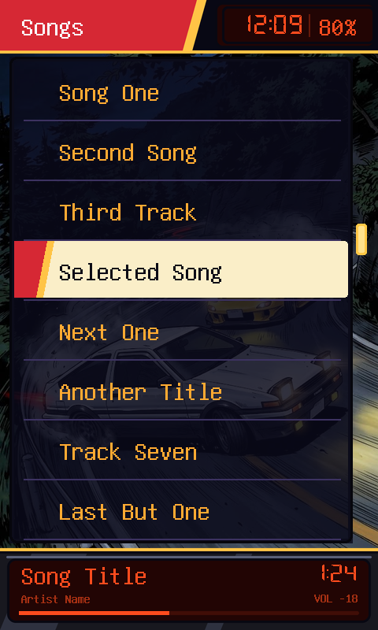
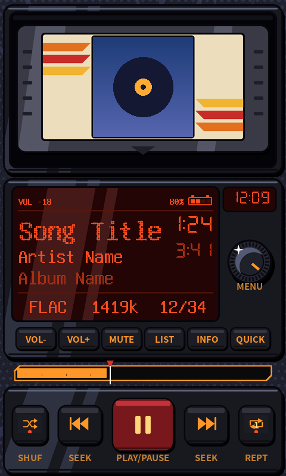

# Drift Mountain

A night-drive car head-unit theme for the HiBy R1 (480x800, touchscreen).

  

- **Playback screen:** head-unit LCD with title, artist, album, times, format, bitrate, volume, battery, clock, preset buttons, seek bar and transport controls.
- **Main menu:** 2-column tile grid with a cream selection bar and red/gold tab.
- **Other menus:** dark-panel lists with the same cream selection bar.
- **Bottom bar:** now-playing strip; tap it to open the playback screen.

## Install

1. Download the latest zip from [Releases](../../../../releases).
2. Copy the `.rockbox` folder into `/.rockbox/` on the SD card (merge folders).
3. On the player: Settings > General Settings > Display > Touchscreen Settings > Touchscreen mode > **Point**.
4. Settings > General Settings > Theme Settings > Browse Theme Files > pick `driftmountain.cfg`.

## Bugs

[Open an issue](../../../../issues/new/choose) with a photo and your Rockbox version.
