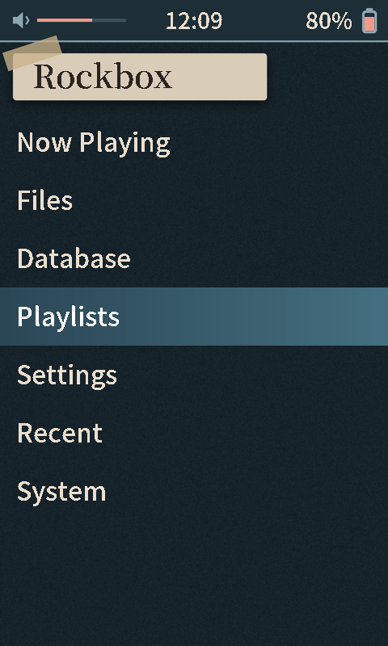
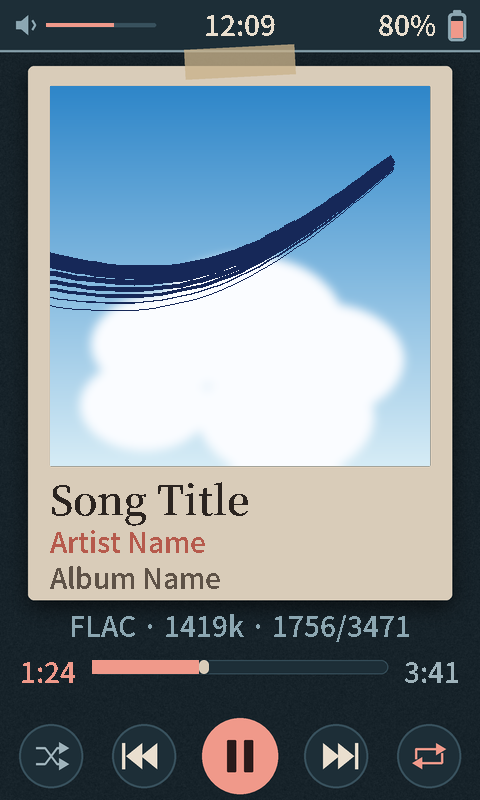

# Pretty Sad

A theme for the HiBy R1 (480x800, touchscreen): a taped polaroid-style album card on a dark blue-green background with coral accents.

 

Album art on a taped, polaroid-style card over a dark blue-green background, with coral accents. Screenshots use placeholder text and a generic cover.

## Install

1. Download [`prettysad-v1.0.zip`](download/prettysad-v1.0.zip) (or the latest from [Releases](../../../../releases)).
2. Copy the `.rockbox` folder into `/.rockbox/` on the SD card (merge folders).
3. On the player: Settings > General Settings > Display > Touchscreen Settings > Touchscreen mode > **Point**.
4. Settings > General Settings > Theme Settings > Browse Theme Files > pick `prettysad.cfg`.

## Bugs

[Open an issue](../../../../issues/new/choose) with a photo and your Rockbox version.
