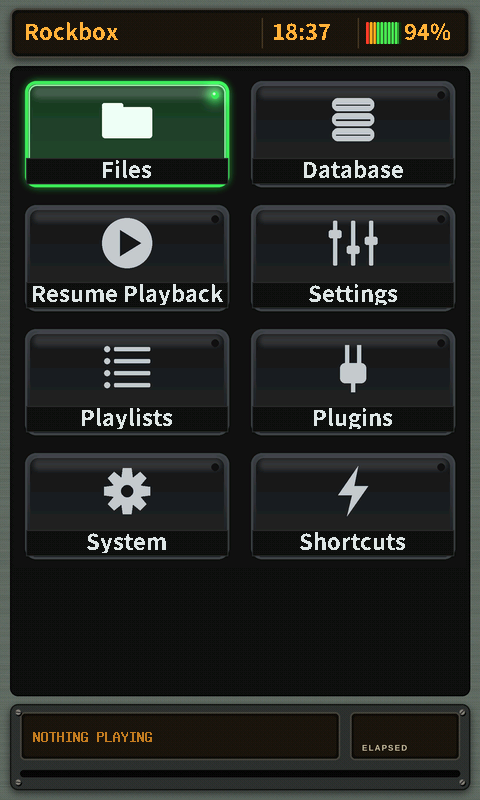
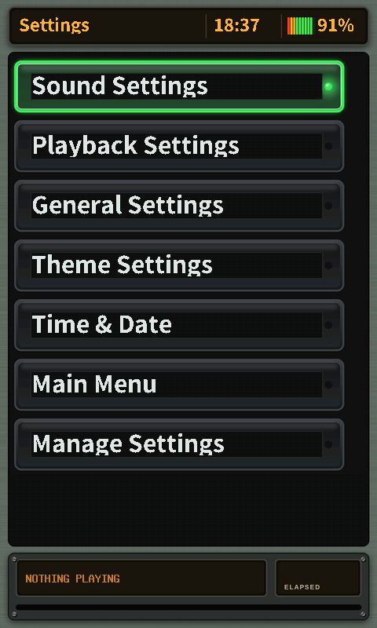
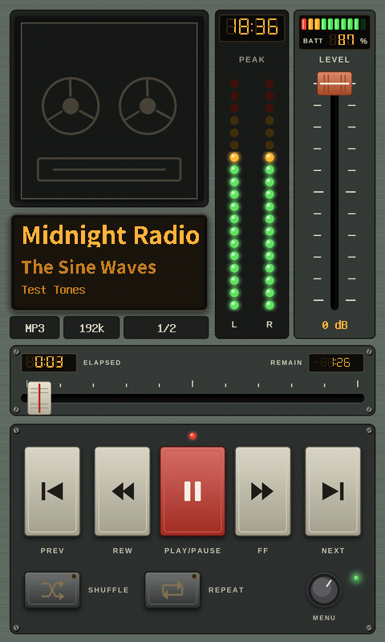
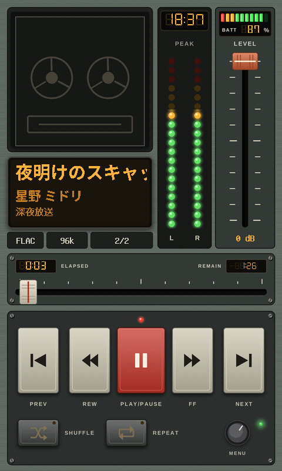

# Studio Console

A theme for the HiBy R1 (480x800, touchscreen): a vintage recording-studio console with glowing green tiles, large clear menu text, tall stereo peak meters, a long touch volume fader and a lamp that lights while playing.

   

Screenshots use placeholder text and a generic cover.

**CJK support:** yes. Japanese, Chinese and Korean text displays correctly.

## Install

1. Download [`studioconsole-v1.1.zip`](download/studioconsole-v1.1.zip) (or the latest from [Releases](../../../../releases)).
2. Copy the `.rockbox` folder into `/.rockbox/` on the SD card (merge folders).
3. On the player: Settings > General Settings > Display > Touchscreen Settings > Touchscreen mode > **Point**.
4. Settings > General Settings > Theme Settings > Browse Theme Files > pick `studioconsole.cfg`.

## Bugs

[Open an issue](../../../../issues/new/choose) with a photo and your Rockbox version.
