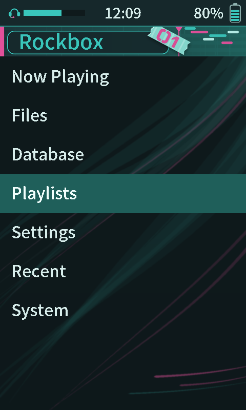
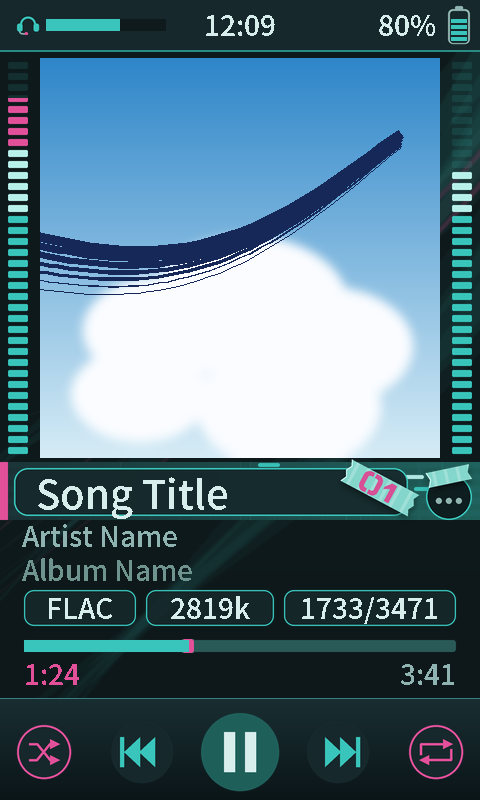

# Teal Vocaldroid

A theme for the HiBy R1 (480x800, touchscreen): a teal and pink digital-audio player with level meters beside the album art.

 

Teal and pink digital look with level meters either side of the album art and a ribbon-style track number tag. Screenshots use placeholder text and a generic cover.

## Install

1. Download [`tealvocaldroid-v1.0.zip`](download/tealvocaldroid-v1.0.zip) (or the latest from [Releases](../../../../releases)).
2. Copy the `.rockbox` folder into `/.rockbox/` on the SD card (merge folders).
3. On the player: Settings > General Settings > Display > Touchscreen Settings > Touchscreen mode > **Point**.
4. Settings > General Settings > Theme Settings > Browse Theme Files > pick `tealvocaldroid.cfg`.

## Bugs

[Open an issue](../../../../issues/new/choose) with a photo and your Rockbox version.
