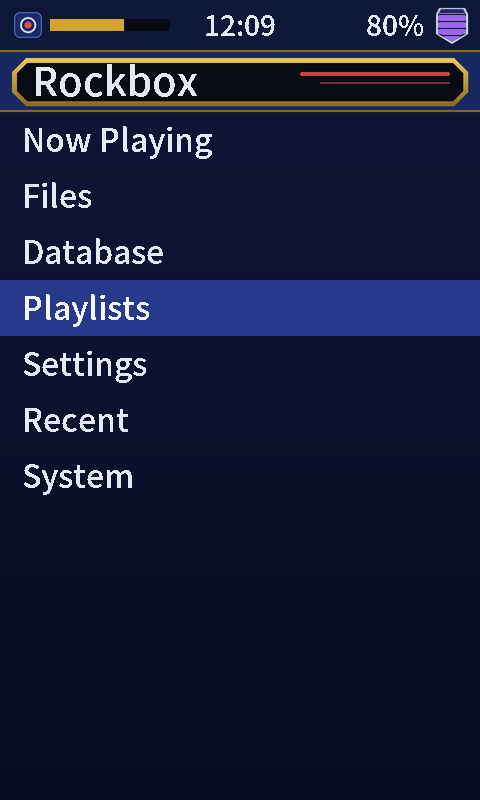
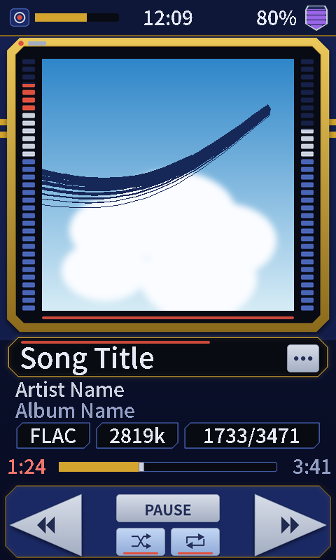

# Waveform Bot HUD

A theme for the HiBy R1 (480x800, touchscreen): a navy and gold sci-fi HUD with VU meters either side of the album art.

 

Navy and gold HUD frame, VU meter bars either side of the album art, and large angular transport buttons. Screenshots use placeholder text and a generic cover.

**CJK support:** yes. Japanese, Chinese and Korean text displays correctly.

## Install

1. Download [`waveformbot-v1.1.zip`](download/waveformbot-v1.1.zip) (or the latest from [Releases](../../../../releases)).
2. Copy the `.rockbox` folder into `/.rockbox/` on the SD card (merge folders).
3. On the player: Settings > General Settings > Display > Touchscreen Settings > Touchscreen mode > **Point**.
4. Settings > General Settings > Theme Settings > Browse Theme Files > pick `waveformbot.cfg`.

## Bugs

[Open an issue](../../../../issues/new/choose) with a photo and your Rockbox version.
